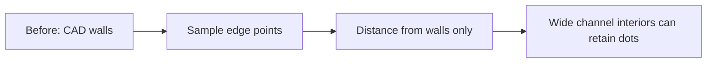
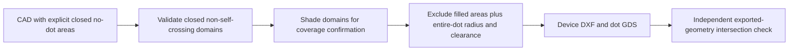

# MIBQT-28: dot-grid portal local implementation

Reviewed 2026-11-04. Branch: `feat/dot-grid-portal-v1`, based on `699e9e82`.
Canonical status remains **In progress** in the ENG-MIBQT tracker. No Cloudflare deployment,
resource provisioning, invitation email, fabrication submission or desktop ABI change occurred.

## Delivered

Invite-only Worker application with verified Access JWTs, live D1 membership checks,
tenant-scoped private R2 storage, bounded DXF/DWG uploads, explicit units and normalized
geometry confirmation. Queued private Python/LibreDWG containers reuse codec contract 1.
Exports are combined device/dots DXF, dots-only GDS, and registry/codebook/manifest ZIP.
D1 reserves immutable identities; failed output writes do not publish registry entries.
The real UI includes a state-gated Driver.js walkthrough, restart/skip and feedback.

See [implementation](../../tools/dot_grid_portal/README.md) for architecture, setup,
limits, supported geometry and deployment preparation. The UI also presents before/after
flow diagrams. [Test boundaries](../../tools/dot_grid_portal/tests/README.md) distinguish
real subsystem execution from fixture-backed browser behavior.

## Verified locally

- TypeScript checks for Worker and browser passed; Vite production build passed.
- Nine Vitest tests passed: seven API/JWT cases, actual local workerd D1/R2 streaming
  upload, and a real Python job round-trip with output-write failure/retry/replay.
- Host Python suite: seven passed, one DWG test skipped (converter is container-only).
- Playwright: one actual browser walkthrough passed, including Driver.js controls.
  API responses are fixtures; screenshot is UI evidence, not cloud/CAD execution evidence.
- Wrangler deployment dry-run passed with container rollout disabled; no account write.
- Docker image built with hash-pinned LibreDWG 0.14; runtime is non-root and tested offline.
  All eight container Python tests passed, including genuine DWG conversion through map export.
- Focused native C++ registry/codebook/codec/decoder harness accepted the exported registry
  and localized a synthetic observation at `(2499.998, 2500.002)` micrometres.
  This is not full desktop GUI import or real-camera verification.
- Repository documentation checker passed.

The seed-8 negative fixture intentionally fails the existing decoder discrimination gate;
no registry or map is published. Positive fixtures use independently validated seed 9.
A faulty DXF-to-DWG writer round-trip was rejected during test development. The final
DWG test instead uses the genuine `2000/Line.dwg` fixture from the pinned GNU source
archive; conversion must pass strict DXF audit, normalization and map generation.

## Remaining acceptance work

1. Select an authorized Cloudflare account/hostname and establish Access policy, D1/R2/queues
   and container eligibility. Import existing production registry identities before uploads.
2. Prove live authentication, two-tenant isolation, revoke behavior, queue/container lifecycle,
   representative customer DWGs and downloaded map import in the actual MIB desktop.
3. Implement and validate chunked full-wafer generation: current one-million-node bound
   deliberately rejects a 100 mm wafer at 30 micrometre pitch.
4. Keep fabrication qualification separate under MIBQT-27. Synthetic decoding does not
   establish optical readability, manufacturing DRC, mask compensation or fabrication approval.

There is no running background deployment or promise of automatic production completion.

## Superseding review correction — 2026-11-04

Gavin identified dots inside the illustrative chip's channel. Prior workflow/decoder checks
were not sufficient evidence of fluidic exclusion: the old engine measured proximity to
sampled edges but did not fill the channel interior. The earlier demo is superseded and its
customer downloads are blocked, with original files retained for audit.

New inputs must declare closed NO_DOT polygons/circles covering channels, chambers and ports.
Open, missing, degenerate or self-intersecting no-dot boundaries fail closed. The generator
uses filled domains and exact segment distance against displaced dot centres, including the
6 µm radius plus 50 µm clearance. User confirmation includes shaded no-dot coverage. This
requires complete input semantics; it does not automatically infer fluid interiors from
unlabelled walls. Existing sampled edge exclusion remains supplementary, not manufacturing DRC.

Customer surface: device+dots DXF / dots GDS only. Map ZIP URLs now return 404 for all roles;
seeds and internal registry records are omitted from detail responses. No pattern implementation,
registration or decoder explanation remains in the customer tour or public sample metadata.

Actual design attempted: Drive file 1EvWd4mMUWA88gVdpO9u1pi6qoWnjK4c5,
Wafer_soRT-DC chip_channel layer_height 30 um_1.5% enlarged.dwg (333918 bytes).
The converter emitted structural/handle errors. Parsed output has 5180 LINE, 2202 CIRCLE,
1620 ARC, 88 REGION, 80 LWPOLYLINE and 1 MTEXT, all on layer 0; units header is mm.
Inspection rejects REGION/MTEXT. We did not flatten/drop these objects or generate a
purportedly safe original-wafer export. Full-wafer node bounds also remain unresolved.
A reliable CAD export and verified fluid-domain interpretation are required for this source.

Project context: master index, playbook, ENG-MIBQT Overview/Actions/Files read live at about
14:43–14:45 HKT. The project tracker has no accessible `Operating guide` tab (range read
returned INVALID_ARGUMENT); do not treat that guide as reviewed. MIBQT-28 remains in progress.

### Changed flow and observed verification

Live review design `dg-56fdf57d-4613-4895-aadc-7eaad3a306c8`: real HTTPS upload,
inspection, confirmation, generation and both downloads passed. Independent gdstk offset
check of all 85,060 exported dots found zero channel/port/50 µm-clearance intersections;
DXF and GDS positions matched. This checks the declared illustrative fluid domain, not
fluid performance or customer CAD semantics. Demo SVGs were regenerated from these exports.
Live Driver.js example tour: all four steps passed; two customer download links and no
registration/codec wording. Screenshot inspected. Map endpoint denied with 404.
Local Python tests: 9 passed, one container-only DWG fixture skipped locally; API/job/runtime
tests: 10 passed; browser fixture tests: 2 passed; TypeScript checks/build and docs check passed.
Deployment uses a derived image from the existing locally built LibreDWG image with only
updated generator code, preserving the old stopped container for rollback. No routing or
other services changed. Source customer DWG and debug artifacts remain local, not public assets.

Container-only real DWG fixture check: 1 passed (rejects missing explicit no-dot domain after conversion). This is not the customer DWG acceptance test.
