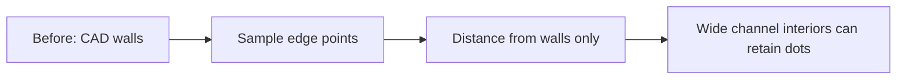
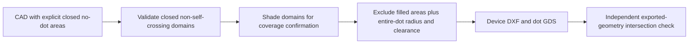

# MIBQT-28: dot-grid portal local implementation

Reviewed 2026-11-04. Branch: `feat/dot-grid-portal-v1`, based on `699e9e82`.
Canonical status remains **In progress** in the ENG-MIBQT tracker. No Cloudflare deployment,
resource provisioning, invitation email, fabrication submission or desktop ABI change occurred.

## Delivered

Invite-only Worker application with verified Access JWTs, live D1 membership checks,
tenant-scoped private R2 storage, bounded DXF/DWG uploads, explicit units and normalized
geometry confirmation. Queued private Python/LibreDWG containers reuse codec contract 1.
Exports are combined device/dots DXF, dots-only GDS, and registry/codebook/manifest ZIP.
D1 reserves immutable identities; failed output writes do not publish registry entries.
The real UI includes a state-gated Driver.js walkthrough, restart/skip and feedback.

See [implementation](../../tools/dot_grid_portal/README.md) for architecture, setup,
limits, supported geometry and deployment preparation. The UI also presents before/after
flow diagrams. [Test boundaries](../../tools/dot_grid_portal/tests/README.md) distinguish
real subsystem execution from fixture-backed browser behavior.

## Verified locally

- TypeScript checks for Worker and browser passed; Vite production build passed.
- Nine Vitest tests passed: seven API/JWT cases, actual local workerd D1/R2 streaming
  upload, and a real Python job round-trip with output-write failure/retry/replay.
- Host Python suite: seven passed, one DWG test skipped (converter is container-only).
- Playwright: one actual browser walkthrough passed, including Driver.js controls.
  API responses are fixtures; screenshot is UI evidence, not cloud/CAD execution evidence.
- Wrangler deployment dry-run passed with container rollout disabled; no account write.
- Docker image built with hash-pinned LibreDWG 0.14; runtime is non-root and tested offline.
  All eight container Python tests passed, including genuine DWG conversion through map export.
- Focused native C++ registry/codebook/codec/decoder harness accepted the exported registry
  and localized a synthetic observation at `(2499.998, 2500.002)` micrometres.
  This is not full desktop GUI import or real-camera verification.
- Repository documentation checker passed.

The seed-8 negative fixture intentionally fails the existing decoder discrimination gate;
no registry or map is published. Positive fixtures use independently validated seed 9.
A faulty DXF-to-DWG writer round-trip was rejected during test development. The final
DWG test instead uses the genuine `2000/Line.dwg` fixture from the pinned GNU source
archive; conversion must pass strict DXF audit, normalization and map generation.

## Remaining acceptance work

1. Select an authorized Cloudflare account/hostname and establish Access policy, D1/R2/queues
   and container eligibility. Import existing production registry identities before uploads.
2. Prove live authentication, two-tenant isolation, revoke behavior, queue/container lifecycle,
   representative customer DWGs and downloaded map import in the actual MIB desktop.
3. Implement and validate chunked full-wafer generation: current one-million-node bound
   deliberately rejects a 100 mm wafer at 30 micrometre pitch.
4. Keep fabrication qualification separate under MIBQT-27. Synthetic decoding does not
   establish optical readability, manufacturing DRC, mask compensation or fabrication approval.

There is no running background deployment or promise of automatic production completion.

## Superseding review correction — 2026-11-04

Gavin identified dots inside the illustrative chip's channel. Prior workflow/decoder checks
were not sufficient evidence of fluidic exclusion: the old engine measured proximity to
sampled edges but did not fill the channel interior. The earlier demo is superseded and its
customer downloads are blocked, with original files retained for audit.

New inputs must declare closed NO_DOT polygons/circles covering channels, chambers and ports.
Open, missing, degenerate or self-intersecting no-dot boundaries fail closed. The generator
uses filled domains and exact segment distance against displaced dot centres, including the
6 µm radius plus 50 µm clearance. User confirmation includes shaded no-dot coverage. This
requires complete input semantics; it does not automatically infer fluid interiors from
unlabelled walls. Existing sampled edge exclusion remains supplementary, not manufacturing DRC.

Customer surface: device+dots DXF / dots GDS only. Map ZIP URLs now return 404 for all roles;
seeds and internal registry records are omitted from detail responses. No pattern implementation,
registration or decoder explanation remains in the customer tour or public sample metadata.

Actual design attempted: Drive file 1EvWd4mMUWA88gVdpO9u1pi6qoWnjK4c5,
Wafer_soRT-DC chip_channel layer_height 30 um_1.5% enlarged.dwg (333918 bytes).
The converter emitted structural/handle errors. Parsed output has 5180 LINE, 2202 CIRCLE,
1620 ARC, 88 REGION, 80 LWPOLYLINE and 1 MTEXT, all on layer 0; units header is mm.
Inspection rejects REGION/MTEXT. We did not flatten/drop these objects or generate a
purportedly safe original-wafer export. Full-wafer node bounds also remain unresolved.
A reliable CAD export and verified fluid-domain interpretation are required for this source.

Project context: master index, playbook, ENG-MIBQT Overview/Actions/Files read live at about
14:43–14:45 HKT. The project tracker has no accessible `Operating guide` tab (range read
returned INVALID_ARGUMENT); do not treat that guide as reviewed. MIBQT-28 remains in progress.

### Changed flow and observed verification

Live review design `dg-56fdf57d-4613-4895-aadc-7eaad3a306c8`: real HTTPS upload,
inspection, confirmation, generation and both downloads passed. Independent gdstk offset
check of all 85,060 exported dots found zero channel/port/50 µm-clearance intersections;
DXF and GDS positions matched. This checks the declared illustrative fluid domain, not
fluid performance or customer CAD semantics. Demo SVGs were regenerated from these exports.
Live Driver.js example tour: all four steps passed; two customer download links and no
registration/codec wording. Screenshot inspected. Map endpoint denied with 404.
Local Python tests: 9 passed, one container-only DWG fixture skipped locally; API/job/runtime
tests: 10 passed; browser fixture tests: 2 passed; TypeScript checks/build and docs check passed.
Deployment uses a derived image from the existing locally built LibreDWG image with only
updated generator code, preserving the old stopped container for rollback. No routing or
other services changed. Source customer DWG and debug artifacts remain local, not public assets.

Container-only real DWG fixture check: 1 passed (rejects missing explicit no-dot domain after conversion). This is not the customer DWG acceptance test.

## Actual-wafer import recovery — follow-up, 2026-11-04

User requested support for ordinary uploads rather than asking customers to repair
or re-export this wafer. The local review now uses an operator-provisioned ODA
27.10 converter to ACAD2000 DXF, preserving 88/88 REGION payloads. All 88 extract
as complete planar straight-edge polygons. Unsupported/empty/holed/nonplanar bodies
still fail closed, with sanitized actionable customer diagnostics. Converter timeout
kills its whole process group; converter inputs use a fixed name in a fresh private
directory. No customer executable or shell arguments are accepted.

Unlabelled closed geometry is offered as unselected no-dot candidates. A closed
shape is not automatically a fluid channel. The UI supports zoom, fit, click/select,
clear, explicit coverage confirmation, and a four-step state-gated Driver.js tour.
Annotations are preserved; temporary exclusion geometry does not enter device exports.
Large geometry is in private object storage; only validated choices/metadata stay in D1.

Live original-DWG upload `dg-ef30fe8b-e683-4b51-960d-b22116ef59cc` reached
`awaiting_confirmation` through the real HTTPS service and container. It reports
88 recovered REGIONs, 9170 device entities, 3210 candidate closed areas and 20 open
fragments. Selected µm interpretation gives 110000 × 110000 µm bounds; the mm header
conflict is surfaced. Source SHA-256:
`4fbbea1a29ab82b7852dbcfa5b77de6fa538b8b96251ff989095a3944832a7fb`.

Verification: 15/15 offline container Python tests passed (including actual private
wafer and genuine DWG fixture); 13/13 API/runtime/job tests; 3/3 browser fixture tests;
TypeScript checks, frontend build and repository documentation check passed. The live
wafer browser rendered all 3210 candidates, toggled an area, exercised the four-step
tour, kept Add dots disabled at the wafer capacity gate and cleared the temporary
selection afterward. Screenshot inspected. Private evidence remains under ignored
`data/wafer-import-v2/`. An additional real-wafer test passed after the final large-circle
preview refinement. Existing stopped review containers remain available for rollback;
no routing or other services changed.

**Still open:** full-wafer dot generation exceeds the existing node cap; the actual
fluid-domain selection, 20 open fragments and physical dimensions need confirmation.
No actual-wafer mask was generated, and no fabrication approval is implied. Production
converter provisioning/licensing and cloud deployment remain separate from this private
review deployment. This supersedes the earlier “manual CAD re-export required” conclusion
for this particular file, not all possible DWG or ACIS entities.

## Follow-up: wafer generation capacity

The import-only delivery did not generate wafer dots. Added bounded batches, disk
spooling, indexed exact region-distance filtering, streamed DXF/GDS, and streamed
review object storage. Scalar-engine equivalence and export read-back regressions
cover the unchanged codec. Limits remain explicit; this is not an unbounded cap raise.

Measured on the actual normalized source: 6,387,278-dot capacity-only run, 65.24 s,
423 MiB peak RSS. A separate conservative all-closed-polygons run: 3,452,492 dots,
94.35 s, 342 MiB peak RSS. An independent streaming DXF/GDS reader checked every
exported centre against the spool, and analytic rectangle clearance checked all
20 outer chip boundaries: zero mismatches and zero violations. The capacity-only
output has incomplete exclusions and must not be published as a usable mask.

User choice of surrounding-wafer-only versus inside-chip placement is pending;
no test output has been accepted as a manufacturing mask.

Deployment verification: private image `mib-dot-grid-portal:wafer-batched` completed
actual conservative wafer generation offline at 4 GiB / 2 CPUs with the normal
subprocess limits. 18 Python tests (including actual DWG preservation), 13 API/runtime
checks and 3 Playwright tests passed. The live tailnet wafer record was capacity-
upgraded only after checking its normalized source hash; the old inspection object
and old container were retained. Live Driver.js review, 1,008-polygon selection,
capacity enablement and coverage-reset gate passed without saving any selections
or submitting a mask. Actual-dot rendering is covered by UI fixtures; no customer
wafer generation was submitted while the exclusion preference remains unanswered.

## Redesign: individual chips after cutting

The whole-chip exclusion workflow was unsuitable for post-cut microscopy. The new
contract separates chip inclusion from fluid exclusion, preserves solid islands in
fluid faces, and rejects missing/overlapping/empty chip boundaries. It has no drawing-
bounds or inferred-wafer fallback. Review controls distinguish roles, allow missing
rectangular boundaries, and assign only geometry-verified translated copies.

Actual-wafer proposal: smaller rectangles as conservative placement envelopes,
20 matched fluid-network faces with holes, and all 20 short open fragments covered
by the selected fluid regions. Local generation: 2,689,252 dots, 133,927–135,093 per
chip, 106.65 s wall time, 364 MiB peak RSS. Independent checks of every DXF/GDS
coordinate and analytic cut-clearance / point-in-polygon plus direct fluid-edge
distances found zero violations. This is a review draft, not physical saw-line or
microscope qualification. Source DWG remains unchanged.

Live review delivery: `Wafer_soRT — post-cut review draft`
(`dg-6f71ac43-66f4-403f-960d-b55ec6876334`) was uploaded from the original DWG,
inspected, assigned 20 verified translated chip boundaries and 20 fluid faces via
real UI controls, and generated through the normal queue. The live run has
2,689,289 dots (133,926–135,105 per chip). Both customer downloads were streamed
back over HTTPS, hashed against the worker manifest, and independently checked:
zero coordinate mismatches, zero dots outside chip envelopes, zero cut/fluid
clearance violations, and all 9,171 normalized source entities unchanged. The
private map endpoint returned 404. No physical fabrication or camera test occurred.

The real Driver.js review reached its feedback checkpoint before generation and
again on the completed design. All 20 detail choices were present; first/last
chip views contained 908/900 exact dot circles. The magnified frame is square and
Fit drawing resets to the occupancy overview; there were no browser page errors.
Legacy outputs remain stored, but lack the new placement contract and are not
served as cut-chip-ready downloads. Production Cloudflare rollout remains separate.

Regression coverage: 24 Python checks including actual DWG preservation and
post-cut/hole semantics, 14 API/runtime/job checks, and 3 Playwright flows. The
full-wafer worker was also exercised offline at 4 GiB / 2 CPUs with normal limits.
Private verification artifacts and scripts remain under
`/mnt/hdd/developer-data/mib-studio-qt/wafer-postcut-v3/`, with the delivered run in
`live/`; no customer CAD or generated mask was added to Git.

Missing-boundary regression: a 6 mm CAD drawing can now receive an explicitly
defined 8 mm chip envelope extending to negative mask coordinates. Generation,
codebook origin, raster bounds and Fit drawing expand consistently without moving
source entities. The ordinary overall capacity limits still apply. A generator
round-trip and the UI flow cover this case; no drawing-bounds clipping fallback remains.

## Oversized-file correction

The previous combined ASCII DXF repeated 2.69 million circle records and was
reported unopenable by the user. Compact alternatives preserve the same mask:
combined DWG 44.04 MB and dots-only OASIS 1.52 MB. Original compatibility files
remain available rather than being overwritten. The delivered wafer's identity,
geometry and dot positions are unchanged. See DotGridPortal vault note for
round-trip evidence; independent scripts/reports are retained in the private
`compact-mask/` artifact directory. Target user application is not yet known;
opening in that application remains unverified. The broader upload/geometry
review workflow has not been simplified by this export fix.

Acceptance: 25 container Python tests (including real DWG), 14 API/job tests
(including compact-artifact storage failure), and 3 browser flows pass. The
full-wafer compact export also completes with network disabled, 4 GiB container
memory, 2 CPUs and the worker's 3 GiB address-space bound. Live HTTPS downloads
match verified file hashes. Real Driver.js walkthrough reaches feedback; compact
links/sizes are visible, compatibility links collapsed, no page errors observed.
