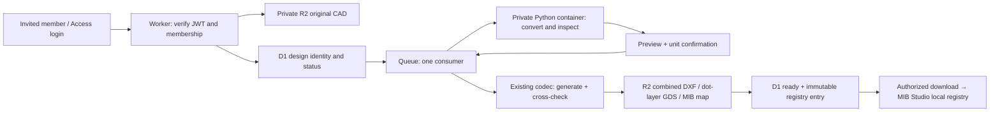

# Dot Grid portal — MIBQT-28

Invite-only CAD preparation service for MIB Studio. This is a reviewable v1 implementation,
not a deployed service or a fabrication qualification.

## What it does

- Verifies Cloudflare Access RS256 JWT signature, issuer, audience and expiry on **every** request,
  then checks current D1 membership. No production authentication bypass exists.
- Tenant administrators grant/revoke member access. Invitations are email allowlist entries;
  this app does not send email. A member belongs to one tenant in v1. Tenant members share designs.
- Accepts DXF/DWG, keeps the original in private R2, requires explicit units, normalizes to
  micrometres with a recorded source-to-mask transform and shows the converted drawing.
- Rejects unsupported or non-planar geometry. Blocks, text, splines, polyline bulges/widths
  must be converted/exploded in the authoring application, not silently ignored.
- Requires user confirmation before queued generation. Preserves device geometry in the
  combined DXF; exports **dots-only** GDS and a ZIP containing registry, codebook, manifest and instructions.
- Uses existing frozen codec contract 1. No core/C++ ABI changes. Seeds are allocated by
  the authoritative D1 database, not per customer; failed reservations are never deleted/reused.
- Registers only after cross-design synthetic checks and all three R2 writes succeed.
  Download authorization rechecks tenant ownership and ready status. Partial outputs are not downloadable.
- Includes an in-app Driver.js tour, skip/close/restart, state-gated steps and saved feedback.

## Architecture



The container has no internet access, runs as a non-root user and has ephemeral job files.
A retry rehydrates the source/normalized DXF from R2. D1 and R2, not the container disk,
are the persistent record. The queue's `max_concurrency: 1` is an intentional v1
registration invariant: do not raise it without a registration coordinator/version fence.

## Local verification

From this directory (Node compatible with the pinned Wrangler; Python 3.14):

```sh
npm ci
python3 -m venv .venv
.venv/bin/pip install -r generator/requirements.lock.txt
npm run types
npm run check
npm test
.venv/bin/python -m pytest tests/test_pipeline.py -q
npm run build
npx playwright install chromium --only-shell
npx playwright test
npx wrangler deploy --dry-run --containers-rollout none
```

`npm test` includes real SQLite authorization queries, real RS256 signatures, local
workerd D1/R2 upload, and a real FastAPI/Python job round trip. The latter substitutes
local storage/transport adapters for cloud bindings. The browser test drives the actual
UI/Driver.js with fixture API responses: it is **not** cloud authentication or CAD proof.
No test calls a live Cloudflare account.

Container build from repository root:

```sh
docker build -f tools/dot_grid_portal/Dockerfile -t mib-dot-grid-portal:local .
```

The image compiles hash-pinned GNU LibreDWG 0.14. Its GPL license is retained in the image;
review distribution obligations before redistributing the image. The source release URL
and hash are in the Dockerfile. Conversion failures fail closed; support is not a promise
that every DWG version/entity will convert losslessly. The converted preview remains required.

## Deployment preparation (not performed automatically)

1. Select the authorized Cloudflare account and portal hostname. Containers require account
   eligibility/billing; no resources or spending are provisioned by the local tests.
2. Create a private R2 bucket, D1 database, primary queue and dead-letter queue. Replace the
   placeholder D1 ID, names and Access settings in `wrangler.jsonc`. Keep R2 public access off.
3. Configure a self-hosted Cloudflare Access application for **all paths** on the hostname,
   with a verified identity provider/one-time PIN policy. Set its issuer and audience.
   Do not rely on Access alone: D1 membership remains the customer authorization boundary.
   Keep `workers_dev` and preview URLs disabled and do not enable asset bypass routes.
4. Apply the D1 migration. Inventory **every existing production local registry**, not just
   the bundled registry. Reserve/import its identities before accepting any uploads.
   Produce reviewable bootstrap SQL:

   ```sh
   .venv/bin/python generator/bootstrap.py --tenant-id example --tenant-name 'Example lab' \
     --admin-email admin@example.org --registry /path/to/existing-registry.json > /tmp/bootstrap.sql
   ```

   This does not execute SQL. Review it and apply it to the intended D1 database using Wrangler.
   Omit `--registry` only when there are genuinely no additional production registries.
   Bootstrap fails on duplicate/mismatched identities instead of rewriting them.
5. Build assets and the container, dry-run, then deploy only to the authorized target.
6. Prove two real invited tenants: login, isolation, DXF and representative DWG upload,
   confirmation, generation, download, revoked access, and MIB Studio registry load.
   Confirm queue retries/DLQ handling and current container limits in the target account.

There is deliberately no preset hostname, account ID or live admin email. Obtain any
required deployment credentials through the existing Vault mechanism; never commit them.

## Current bounds and gaps

- 10 MiB upload, 20 designs/tenant/day, 20,000 model-space entities, 20,000 preview vertices,
  512 kB preview metadata, 1,000,000 lattice nodes, 5-minute subprocess timeout, 3 GiB address-space cap.
  These are conservative v1 bounds, **not full-wafer capacity proof**. A 100 mm wafer at 30 µm
  pitch exceeds the current node bound; full-array chunking is outstanding.
- Fixed validated starting geometry: 30 µm pitch, 12 µm dot, 5 µm displacement;
  no mask shrink/expansion compensation is applied (design scale 1.0).
- Existing keep-out geometry is sampled/heuristic. Do not call it manufacturing DRC.
- Some allocated patterns fail the existing synthetic decoder check. They are not registered;
  retry does not weaken that check. A new design upload allocates a new seed. Automated
  candidate-seed search is a future improvement and must retain all burned reservations.
- Registration means a compatible localization map, **not** a new CAD-overlay viewer,
  fabrication approval, or real-camera localization validation.
- D1/R2 are not a distributed transaction. Partial object writes are hidden until the D1 ready
  transition; retry overwrites only the same job's private outputs. Orphan cleanup is not scheduled.
- The job source is trusted internal queue data. Public requests cannot provide tenant IDs,
  seed values, registry entries, object keys or container routes.
- If retries exhaust, the design becomes failed. A DB outage can instead send a message to
  the DLQ; operator recovery must reconcile the row and replay the same identity, not delete seeds.
- Cloud policy, real customer accounts and full native MIB import remain deployment acceptance work.

## MIB Studio handoff

Extract `mib-map.zip`. Its `registry.json` loads through the existing
`dot_grid.registry_path` setting, merging with the bundled registry. If a local registry
already exists, merge entries with ID/seed validation rather than replace that file.
The decoder reports **mask** coordinates; `manifest.json` records the translation/scaling
from the uploaded drawing. The map ZIP contains no other customer's registry entries.
